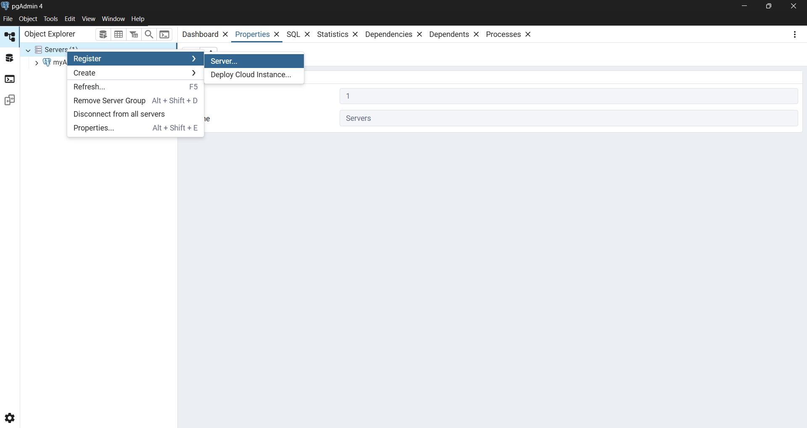
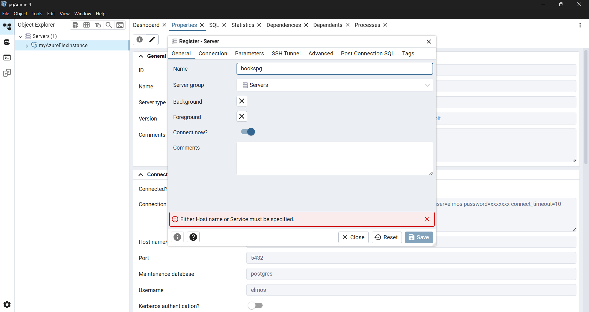
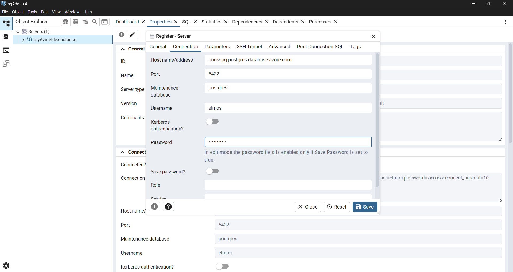

## Lien discord: https://discord.gg/dtbe54kw

### Start docker config:
```docker compose up --build```
### Stop docker config:
```docker compose down```
### Connecting to db
#### PgAdmin 4
- install pgAdmin 4
    windows: https://www.postgresql.org/ftp/pgadmin/pgadmin4/v9.10/windows/
    macOS: https://www.postgresql.org/ftp/pgadmin/pgadmin4/v9.10/macos/
- register database server
<p align="center">
  
</p>
<p align="center">
    
</p>
    **hostname**: bookspg.postgres.database.azure.com
    **port**: 5462
    **username**: elmos
    **password**: booksPrj123
<p align="center">
    
</p>

- click save

